<picture>
  <source media="(prefers-color-scheme: dark)" srcset="assets/header-dark.svg">
  <source media="(prefers-color-scheme: light)" srcset="assets/header-light.svg">
  
</picture>

**[Portfolio](https://anikaitkaushik.vercel.app/)** · [Research](https://anikaitkaushik.vercel.app/research) · [LinkedIn](https://www.linkedin.com/in/anikait-kaushik-9435b1289) · [Email](mailto:anikaitkaushiksep@gmail.com)

I build robots and study why they move the way they do: from field rovers to models of human gait and a wearable lower-limb exoskeleton. Most of that work is hardware, so the case studies live on my portfolio.

### Selected work

| Project | What it is |
| --- | --- |
| [Ganga](https://anikaitkaushik.vercel.app/projects/ganga) | Mars rover, Team Captain. IRC 2026 Champion, 1st of 33 finalist teams |
| [R3 exoskeleton](https://anikaitkaushik.vercel.app/projects/exoskeleton) | Gait capture, Euler–Lagrange modelling and a wearable lower-limb exoskeleton |
| [Alaknanda](https://anikaitkaushik.vercel.app/projects/alaknanda) | Soil subsystem I designed and built for the rover's ABEx mission |
| [LoCoBot digital twin](https://anikaitkaushik.vercel.app/projects/locobot) | Sim2Real MATLAB–ROS framework with a Simscape twin, with MathWorks. In progress |
| [ClimbCart](https://anikaitkaushik.vercel.app/projects/climbcart) | Tracked stair-climber for narrow staircases, from FEA to a tested prototype |
| [Garud](https://anikaitkaushik.vercel.app/projects/garud) | Carbon-fibre competition drone. ISDC 2026 1st Runner-Up, 2nd of 20 |

### On GitHub

- [body-segment-calculator](https://github.com/anikait-kaushik/body-segment-calculator): body segment mass, centre of mass, radius of gyration and inertia from Winter (2009) and de Leva (1996). Offline, one HTML file.
- [Anikait_Portfolio](https://github.com/anikait-kaushik/Anikait_Portfolio): my portfolio site, including a 3D pick-and-place arm and a walking gait model that run in the browser.
